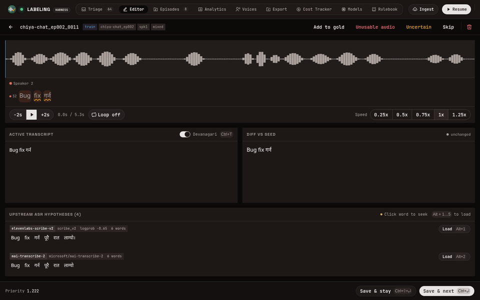
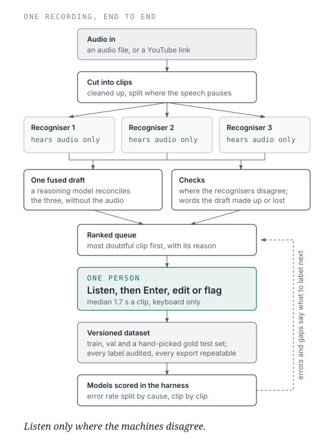

<p align="center">
  
</p>

<h1 align="center">Labeling Harness</h1>

<h3 align="center">Listen only where the machines disagree.</h3>

<p align="center">
  <a href="#how-it-works">How it works</a> ·
  <a href="#tour">Tour</a> ·
  <a href="#quick-start">Quick start</a> ·
  <a href="docs/harness/guide.md">Guide</a> ·
  <a href="docs/nepanglish/README.md">Research</a>
</p>

<p align="center">
  <b>A workbench that turns hours of recorded speech into a verified speech-recognition dataset.</b><br>
  Three recognisers draft every clip, the doubtful ones rise to the top, and one person checks them at keyboard speed.
</p>

<p align="center">
  
  
  
  
  
  
  <br>
  
  
  
  
</p>

<p align="center">
  
</p>

## Why

- **Labelling speech by hand is slow.** Typing a transcript from scratch takes several times as
  long as the audio itself.
- **Speech recognisers are mostly right, and they tend to be wrong where they disagree.** When
  three independent recognisers agree on a clip, it rarely needs fixing.
- **So one person only has to check, not type.** The harness drafts every transcript, ranks the
  clips by doubt, and gives you a keyboard-driven queue: listen, `Enter`, next. On a measured run
  the median clip took **1.7 seconds** to decide, and 76% were accepted as drafted.

It is built for one fast annotator and for code-switched speech. Its first corpus is
Nepali–English podcasts, with English written in Latin script and Nepali in Devanagari.

## How it works



1. **In:** an audio file or a YouTube link, cleaned up and cut into clips where the speech pauses.
2. **Draft:** three cloud recognisers transcribe every clip without seeing each other's output,
   and a reasoning model fuses their three answers into one draft.
3. **Rank:** clips where the recognisers disagree, or where the draft invented or dropped words,
   go to the top of the queue.
4. **Decide:** a person accepts, fixes or flags each clip. The labels export as a versioned
   dataset, and fine-tuned models are scored back in the harness.

## Tour

<table>
<tr>
<td width="50%"><a href="docs/harness/guide.md#triage"></a><br><b>Triage.</b> The most doubtful clip first, with the reason. Red chips mark drafts that failed a check.</td>
<td width="50%"><a href="docs/harness/guide.md#editor"></a><br><b>Editor.</b> Waveform, karaoke playback, what each recogniser heard, and a live diff.</td>
</tr>
<tr>
<td><a href="docs/harness/guide.md#analytics"></a><br><b>Analytics.</b> What the corpus covers and what is missing: speakers, topics, genres, noise.</td>
<td><a href="docs/harness/guide.md#voices"></a><br><b>Voices.</b> Every speaker, followed across recordings by voice, anonymously.</td>
</tr>
<tr>
<td><a href="docs/harness/guide.md#models"></a><br><b>Models.</b> A fine-tuned model's error rate, split by cause and scored against the labels.</td>
<td><a href="docs/harness/guide.md#models"></a><br><b>Model clips.</b> Which clips it got wrong, by genre and by recording condition.</td>
</tr>
<tr>
<td><a href="docs/harness/guide.md#ingest"></a><br><b>Ingest.</b> A YouTube link or a file in; a background queue that resumes after a crash.</td>
<td><a href="docs/harness/guide.md#cost-tracker"></a><br><b>Cost tracker.</b> Every paid model call, by vendor, route and model.</td>
</tr>
<tr>
<td><a href="docs/harness/guide.md#export"></a><br><b>Export.</b> Train, val and gold with a checksummed manifest; the same inputs give the same bytes.</td>
<td><a href="docs/harness/guide.md#rulebook"></a><br><b>Rulebook.</b> Which spellings count as the same word when transcripts are compared.</td>
</tr>
</table>

The screenshots show an invented demo corpus. The [guide](docs/harness/guide.md) walks through
every page.

## Built to be trusted

- **Nothing is overwritten.** Machine transcripts never change and labels are append-only. Every
  decision writes the label, the time it took and an audit row in one transaction.
- **A label says how hard it was looked at:** *verified* (played and read) or *screened*
  (accepted on the disagreement signal). The gold test set takes only verified labels, and only a
  person can put a clip in it.
- **Every paid call is logged** with its vendor, cost and outcome, and an interrupted ingest
  resumes without paying twice.
- **Exports are reproducible:** each comes with a manifest of label version, row counts,
  checksums and git commit, and the same inputs give byte-identical files.
- **The schema changes only through migrations**, each with a working downgrade.

## By the numbers

| | |
|---|---|
| Automated tests | 2,500+, run against a real Postgres |
| Design decisions on record | 95, each with its reason and the cost of reversing it |
| API endpoints | 60+ |
| Recognisers per clip | 3 (ElevenLabs, Microsoft, Google), plus a fusion model |
| Labelled with it so far | 342 recordings, 61 hours, 17,000+ clips |

**Stack:** Python 3.13 · FastAPI · SQLAlchemy · Alembic · Postgres · React 19 · TypeScript ·
Vite · shadcn/ui · ONNX Runtime (forced alignment, voice prints) · Modal GPUs (diarization) ·
Docker Compose.

## Quick start

```bash
cp .env.example .env
docker compose up --build        # Postgres, MinIO, API on :8000, app on :5173
```

Open <http://localhost:5173>. To look around without spending anything, load the demo corpus
into a separate database first ([operations.md](docs/harness/operations.md#the-demo-corpus)).

## Case study: Nepanglish

The harness labelled a Nepali–English podcast corpus: 57 hours to train on and a 3.8-hour gold
test set whose speakers never appear in training. Fine-tuning a 1.2B-parameter model on it cut
gold word error from 13.8% to 10.9%, and that model then taught seven student models.
[Read the research →](docs/nepanglish/README.md)

## Documentation

| | For | What |
|---|---|---|
| [Guide](docs/harness/guide.md) | users | Every page, with screenshots |
| [Operations](docs/harness/operations.md) | developers | Setup, configuration, scripts, tests |
| [Architecture](docs/harness/architecture.md) | developers | Pipeline, schema, ranking, API |
| [Decisions](docs/harness/decisions.md) | developers | Why it is built this way |
| [AGENTS.md](AGENTS.md) | coding agents | Rules, invariants and gotchas |
| [Nepanglish research](docs/nepanglish/README.md) | researchers | The corpus, the models, the findings |
