# Guide

A page-by-page tour. Every screenshot comes from the invented demo corpus
(`scripts/seed_demo.py`), so nothing in it is real data. How to run the harness is in
[operations.md](operations.md); how it is built is in [architecture.md](architecture.md).

- [Ingest](#ingest)
- [Triage](#triage)
- [Editor](#editor)
- [Episodes](#episodes)
- [Gold and train](#gold-and-train)
- [Analytics](#analytics)
- [Voices](#voices)
- [Export](#export)
- [Cost tracker](#cost-tracker)
- [Models](#models)
- [Rulebook](#rulebook)
- [Keyboard](#keyboard)

## Ingest

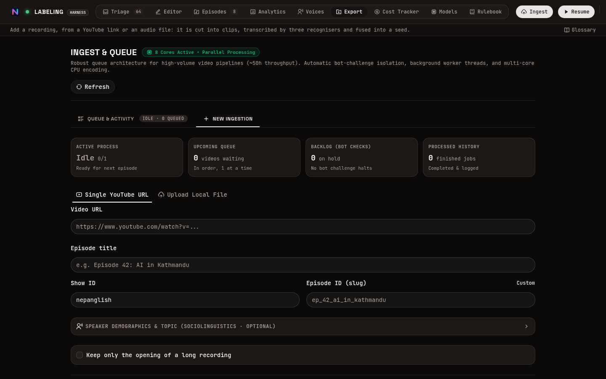

- Paste a **YouTube link** or drop an **audio file** (`.mp3`, `.m4a`, `.wav`). For a link, the
  server fetches the audio itself and fills in the title.
- Six stages run in the background and stream their logs: clean the audio, cut it into clips,
  transcribe, fuse, analyse, build the queue.
- Three recognisers transcribe every clip, and none sees another's output, so where they
  disagree is a real signal. One reasoning model then **fuses** the three into a draft per clip
  without hearing the audio; the queue checks that draft before anyone trusts it.
- **It costs money**: three calls per clip, plus one fusion call per ~30 minutes of audio. A link
  longer than four hours is refused; **Keep only the opening** transcribes just the first N
  minutes of a long recording. Set `dry_run: true` in `config/llm_routes.yaml` to try the
  pipeline for free.
- Jobs queue up, run one at a time, and resume by themselves after a crash without paying twice.

## Triage

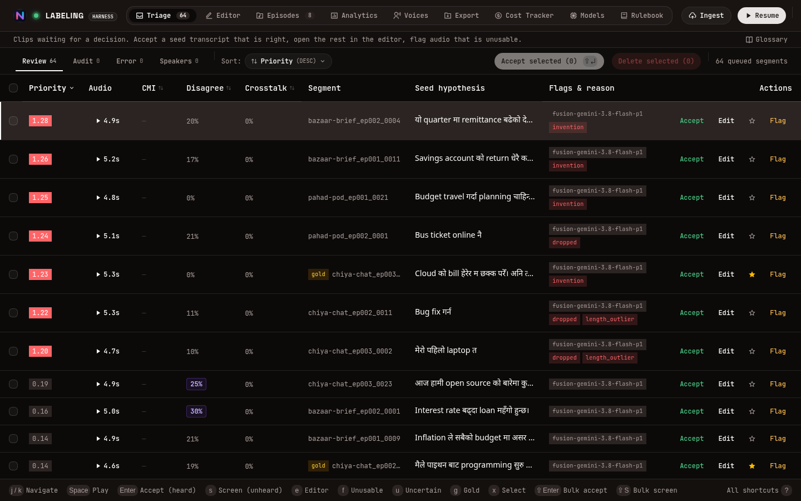

Where the time goes. The most doubtful clip is at the top, with the reason it is there.

- Most clips are right, so the usual move is: listen (`Space`), accept (`Enter`), next.
- A **red chip** means the fused draft failed a hazard check: it has words no recogniser heard,
  dropped words they all heard, or is the wrong length. Those clips sit above everything else and
  must be listened to.
- `s` **screens** a clip, accepting it without listening, where the disagreement says it is safe.
  The label records that it was screened, not verified.
- `e` opens the editor, `f` flags unusable audio, `g` moves a clip into gold.

## Editor

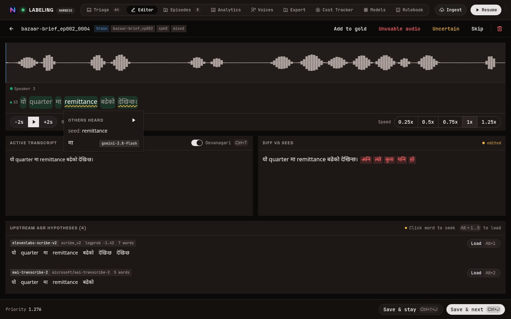

For the clips that need fixing.

- The **waveform** and the draft as a **karaoke line**: the word being spoken lights up, and
  clicking a word plays from there.
- A **wavy underline** marks a word the recognisers heard differently. Click it to see what each
  heard, replay just that moment, and swap the word in one click.
- A live **diff** shows every change against the draft. All the recognisers' transcripts are
  below; `Alt+1…5` loads one.
- Type in Latin and press `Space` for **Devanagari** suggestions; the harness ranks your past
  choices first. `Esc` keeps what you typed.

## Episodes

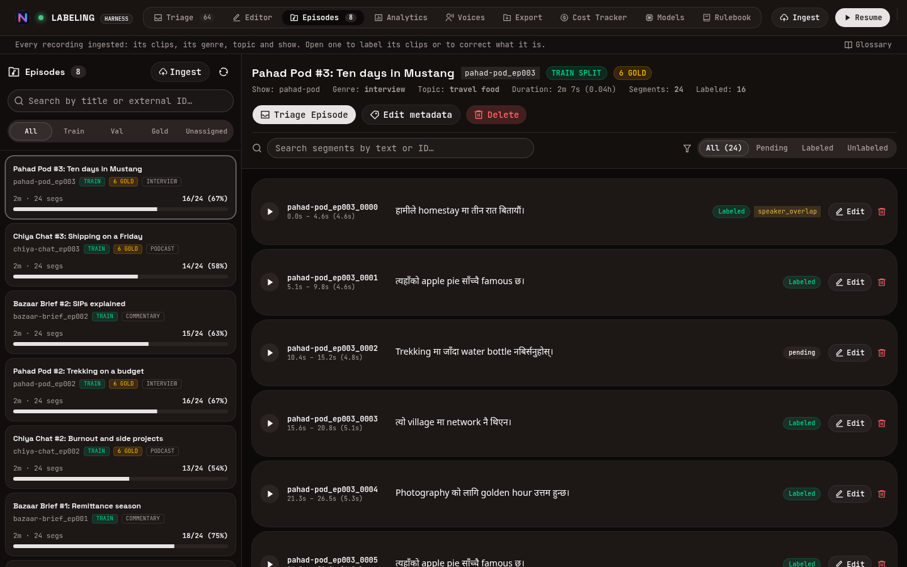

- Every recording, its genre, topic, declared speakers and how much of it is labelled.
- Triage one episode on its own, fix its metadata, or delete it (or one clip), audio and all.

## Gold and train

Every clip sits in one of two **pots**:

- **Train** is where every clip starts. Its episode is drawn into train or val by hash.
- **Gold** is the test set, and a person picks it **one clip at a time** (`g`, the star, or *Add to
  gold*). No algorithm chooses gold, every move is in the audit log, and a screened clip can never
  enter it.

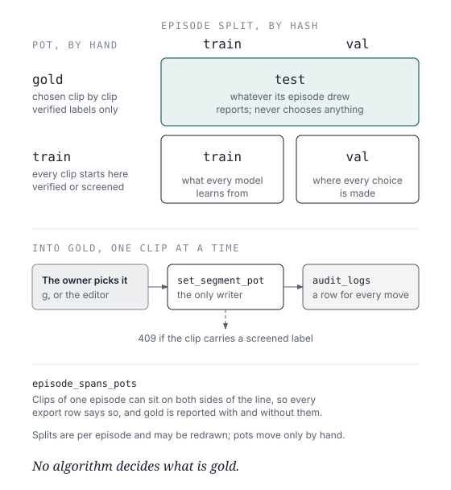

## Analytics

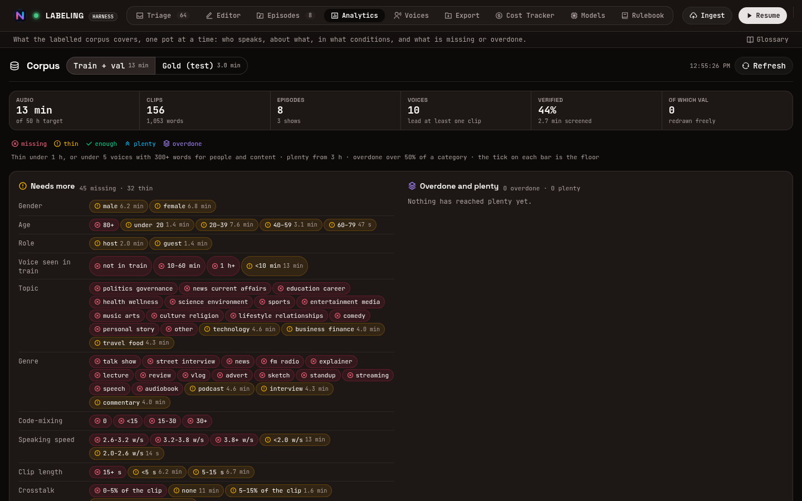

What the labelled corpus covers, for train and gold separately.

- Each clip is counted by **who** talks (gender, age, role, whether a model has heard the voice),
  **what** the recording is (topic, genre, show, how much the languages mix), **how** it was said
  (speed, length, crosstalk) and **how** it was recorded (noise, room, bandwidth).
- Every category is rated *missing*, *thin*, *enough*, *plenty* or *overdone*, so what to record
  next is a glance, not a query.
- Nothing is stored: it is all computed from the labels when the page loads.

## Voices

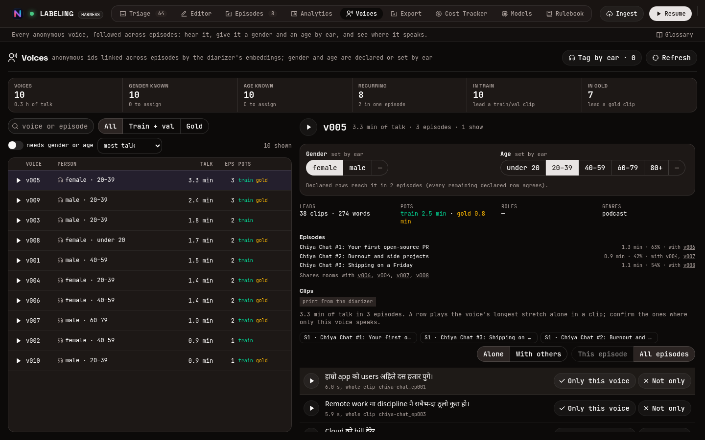

- Speakers are diarized per recording and linked across recordings by voice, as anonymous ids.
- Hear each voice alone, give it a gender and age by ear, and see every episode and pot it
  appears in.

## Export

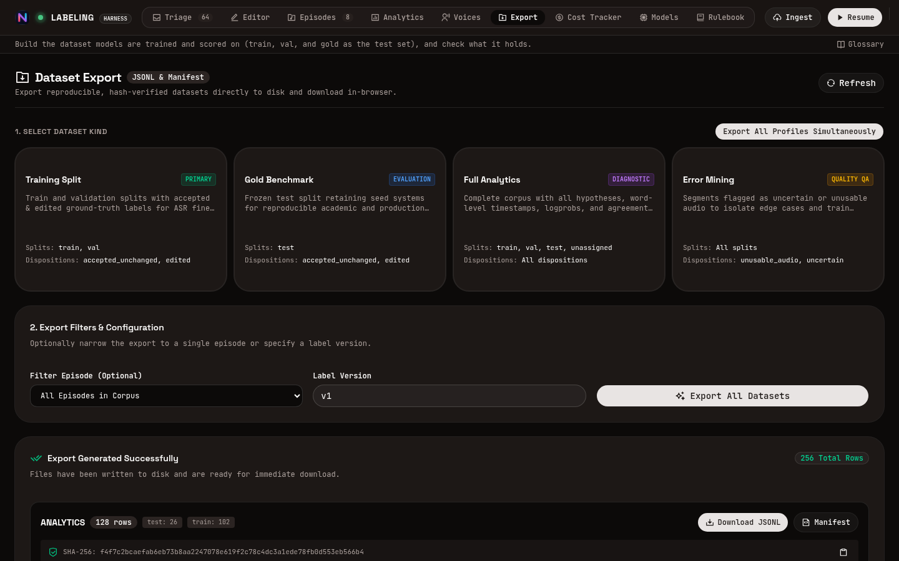

- Four datasets: **training** (train and val), **gold** (the test set), **analytics** (everything,
  with every recogniser's words and timings) and **error mining**.
- Every export ships a manifest: label version, filters, row counts per split, the
  verified/screened mix, file checksums and the git commit. The same inputs give byte-identical
  files.

## Cost tracker

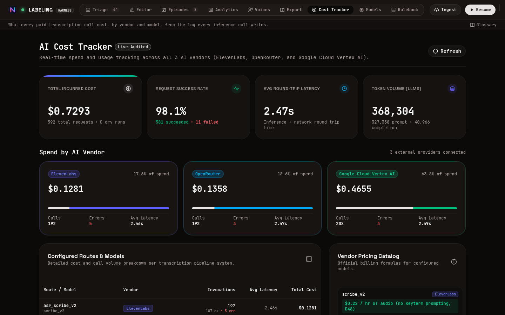

- Every model call is logged, whatever vendor served it and whether it succeeded, failed or was a
  dry run. This page totals them by vendor, route and model.

## Models

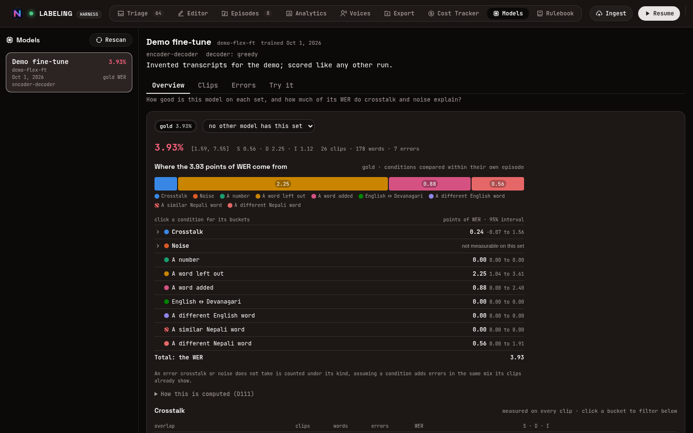

Score a fine-tuned model against the current labels, with no GPU.

- Drop the model's transcripts for gold and val into `data/models/asr/<slug>/` and press
  **Rescan**.
- **Overview**: the word error rate with its confidence interval, split into what caused it:
  crosstalk, noise, numbers, words left out or added, and English or Nepali words got wrong.
- **Clips**: the clips it got most wrong, playable, with crosstalk shaded and an aligned diff;
  filter by genre or by any recording condition.
- **Errors**: every aligned word pair, a confusion table of which word became which, and samples
  of any error class in context.
- **Try it**: record from the microphone and transcribe with the model on the CPU.

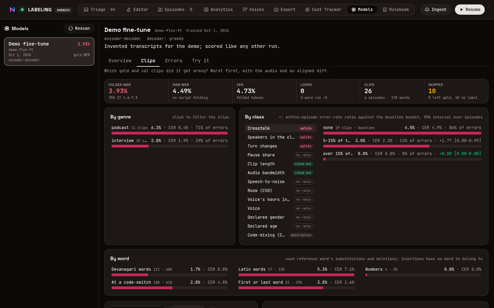

## Rulebook

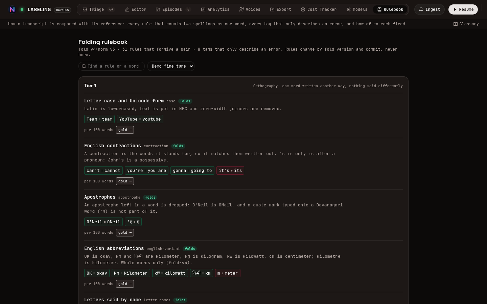

Before two transcripts are compared, both are **folded**: spellings that mean the same word
(`can't` and `cannot`, `OK` and `okay`, an English word in Latin or in Devanagari) count as one.
The rulebook lists every rule with examples and counterexamples, and how often each fired for a
model. A rule never changes a score silently: it is a new fold version.

## Keyboard

| Triage | | Editor | |
|---|---|---|---|
| `j` / `k` | Move between rows | `Ctrl+Space` | Play / pause |
| `Space` | Play / pause row | `Ctrl+Enter` | Save and advance |
| `Enter` | Accept unchanged, advance | `Ctrl+Shift+Enter` | Save and stay |
| `s` | Screen without listening | `Alt+1…5` | Load hypothesis 1–5 |
| `e` | Open in editor | `Alt+←` / `Alt+→` | Seek ∓2 s |
| `f` | Flag unusable audio | `Ctrl+L` | Toggle loop |
| `u` | Mark uncertain | `Ctrl+T` | Toggle transliteration |
| `g` | Add to / remove from gold | `Esc` | Back to triage |
| `x` | Toggle row selection | | |
| `Shift+Enter` | Accept selected rows | | |
| `Shift+S` | Screen selected rows | | |

In the transliteration popup: `1`–`5` pick a candidate, `Enter` takes the first, `Esc` keeps the
Latin as typed. `?` in the app opens the full list.
