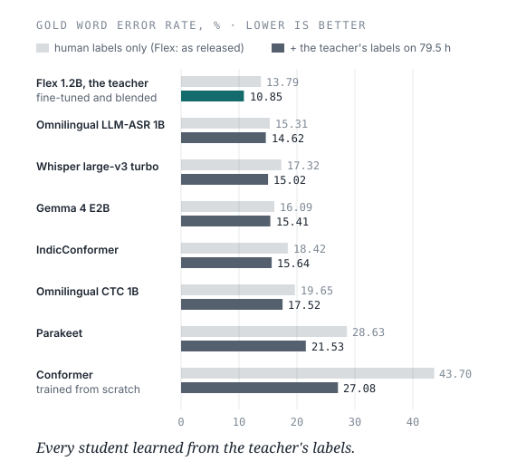
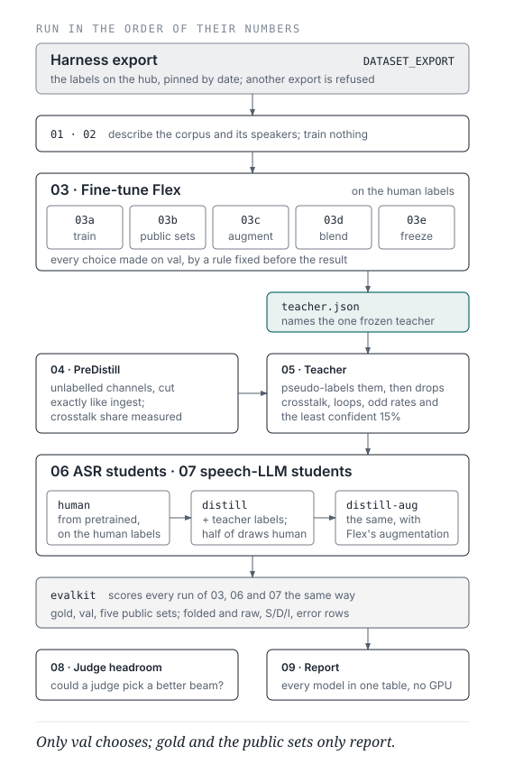

# Nepanglish: the research

The first corpus the [Labeling Harness](../../README.md) built, and the speech-recognition models
trained on it. Nepanglish is how Nepali speakers talk on podcasts: Nepali sentences full of
English words, switching back and forth mid-sentence. The corpus writes English in Latin script
and Nepali in Devanagari, which no off-the-shelf recogniser does reliably.

## The corpus

| | |
|---|---|
| Recordings | 342: podcasts, interviews, news, short reels and more |
| Train and val | 57 hours, labelled with the harness |
| Gold test set | 3.8 hours, 966 clips, every one verified by ear; no gold speaker appears in training |
| Unlabelled audio | 79.5 hours, labelled by the teacher model for the students |

## The models

**Indic-Transcribe-Flex**, a 1.2B-parameter model, fine-tuned on the human labels and blended with
its original weights, is the **teacher**: 10.85% word error on gold, down from 13.79% as
released. It then labelled 79.5 hours of unlabelled audio, and seven **students** of different
architectures trained on the human labels and then on the teacher's. Every number is folded
word error on gold; each model's full results are in its [score card](score-cards/).

## What we learned

- **Every student learned from the teacher's labels**, but not equally: a CTC head gained about
  2–3 points, an LLM decoder under 1 ([findings](findings.md#teacher-labels-help-a-ctc-head-more-than-an-llm-decoder-2026-10-26)).
- **Crosstalk is what is left.** On gold, word error was about 6.5% on clips with no overlapping
  voices, 17% where voices overlap for 5–15% of the clip, and 29% above that. Synthetic crosstalk in training
  did not move real crosstalk ([findings](findings.md#synthetic-crosstalk-does-not-move-real-crosstalk-2026-09-22)).
- **A fair score needs folding rules.** Compared word by word, `टिम` and `team` count as an error;
  that was about half of every system's substitutions on gold. The rules are a rulebook with
  examples and counterexamples, versioned like code ([findings](findings.md#the-fold-was-wrong-both-ways-and-fold-v4-2026-10-02)).
- **An LLM judge picking among the teacher's candidate transcripts lost to, or tied, a simple
  vote of the models** on every set but one ([findings](findings.md#an-llm-judge-is-a-dead-end-g1-closed-2026-10-06)).
- **Diarization cannot say who said a word in overlapped speech**, and neither could the speech
  separators tried, so gold keeps everything said in one stream
  ([findings](findings.md#diarization-cannot-say-who-said-a-word-2026-09-24)).

## How a model is trained

`notebooks/` runs in the order of its numbers (D105): `01_EDA` and `02_Sociolinguistics` describe
the corpus; `03a`–`03e` train Flex, score it on the public Nepali sets, test augmentations, blend
its weights and freeze the teacher; `04_PreDistill` and `05_Teacher` cut and label the unlabelled
audio; `06a`–`06f` train one speech-recognition student each and `07a`–`07b` one speech-LLM
student each; `08_Judge_Headroom` measures what a judge could gain; `09_Report` puts every model
in one table. They run in Colab against the dataset on Hugging Face, each with a `SMOKE` switch for
a few-minute trial run first. Notebooks 03 to 09 are generated from `notebooks/src/` by
`python notebooks/src/build_all.py`.

## Read further

| | |
|---|---|
| [findings.md](findings.md) | Everything measured, newest first |
| [score-cards/](score-cards/) | One per model: every stage on every set, by clip class and word rarity |
| [roadmap.md](roadmap.md) | The experiments still to run |
| [sociolinguistics.md](sociolinguistics.md) | What the corpus can say about how people code-switch |
| [decisions.md](decisions.md) | Why the research is set up the way it is |
